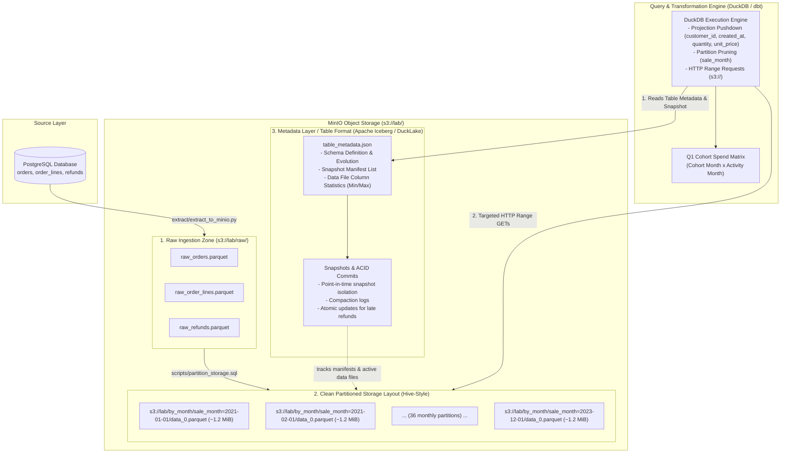

# Checkpoint 1 (Week 6): Storage Layer Design for Question 1

**Course:** Big Data: Persistence Systems and Data Processing Languages  
**Academic Program:** Master SDBIS, Faculty of Economics and Business Administration (FEAA), Alexandru Ioan Cuza University of Iași  
**Project:** Customer Cohort Spend Evolution (Q1 Mini Data Platform)  
**Deliverable Scope:** Storage Layer Architecture & Technical Decision Defense (Formative evaluation, no functional platform required at this checkpoint, no presentation slides).

**Target Analytical Question (Q1 from Annex A):**
> *"How does spend evolve for customers grouped by the month they first ordered?"*

---

## 1. Storage Architecture Diagram (MinIO / S3)

The diagram below details the end-to-end data layout within the MinIO object store (`s3://lab/`), showing the transition from PostgreSQL raw ingest to clean partitioned Parquet files managed by an open table format.

### 1.1 Architecture Flowchart (Mermaid)



### 1.2 Physical S3 Layout on MinIO (`s3://lab/`)

```text
s3://lab/
├── raw/                                        <-- RAW INGESTION ZONE
│   ├── raw_orders.parquet                      (Direct bulk export from PostgreSQL)
│   ├── raw_order_lines.parquet
│   └── raw_refunds.parquet
│
├── by_month/                                   <-- CLEAN / PARTITIONED STORAGE LAYOUT
│   ├── metadata/                               <-- METADATA LAYER (TABLE FORMAT)
│   │   ├── v1.metadata.json                    (Schema definitions, snapshot pointers)
│   │   ├── snap-20231103-01.avro               (Manifest list of active data files)
│   │   └── manifest-file-01.avro               (Partition stats, file paths, min/max values)
│   │
│   ├── sale_month=2021-01-01/                  <-- HIVE-STYLE PARTITIONS
│   │   └── data_0.parquet                      (~1.2 MiB, Snappy compressed, dictionary encoded)
│   ├── sale_month=2021-02-01/
│   │   └── data_0.parquet
│   ├── ...                                     (36 partitions spanning 3 full years)
│   └── sale_month=2023-12-01/
│       └── data_0.parquet
```

### 1.3 Architectural Layer Breakdown

1. **Raw Zone (`s3://lab/raw/`):**
   * High-fidelity, immutable snapshot of the PostgreSQL tables dumped in bulk as Parquet.
   * Preserves full source schemas without alteration, allowing complete reprocessing without re-querying the operational OLTP database.
2. **Partitioned / Clean Storage Layout (`s3://lab/by_month/sale_month=YYYY-MM-01/`):**
   * Denormalized analytical base organized in standard Hive-style partition folders.
   * Consolidated into single files per month (~1.2 MiB each for this dataset), eliminating file fragmentation.
3. **Metadata Layer / Table Format (e.g., Apache Iceberg / DuckLake):**
   * Sits on top of the physical Parquet files.
   * Maintains snapshot isolation, manifest trees, schema evolution, and file-level metrics (row counts, null counts, min/max bounds), shielding analytical queries from raw storage churn.

---

## 2. The 4 Mandatory Technical Decisions (Defended for Q1)

Each team member must be prepared to articulate the choice made, the rejected options, and the specific justification tied to Q1.

### Decision A: File Format (Parquet vs. CSV / JSON)

* **Our Choice:** **Apache Parquet** (Columnar format with Snappy/Zstd compression and embedded statistics).
* **Rejected Alternatives:**
  * **CSV:** Row-based and uncompressed by default. Lacks data types (requiring CPU-intensive type inference and parsing on every read). Inability to project individual columns forces full-line I/O.
  * **JSON / JSON Lines:** Massive text overhead due to repeating schema keys on every line. Very slow to parse in vectorized query engines.
* **Q1 Justification:**
  * Cohort spend analysis measures customer expenditure over time. It strictly requires **only 4 columns** from the transaction line items: `customer_id`, `created_at`, `quantity`, and `unit_price`.
  * Parquet stores data column-by-column rather than row-by-row. When DuckDB queries MinIO over S3, it leverages **column projection pushdown**: it issues HTTP `Range` GET requests targeting *only the byte offsets* of those 4 columns, skipping 80%+ of physical I/O and all unneeded transactional fields (e.g., billing notes, delivery addresses, transaction tokens).

---

### Decision B: Partition Key (`sale_month=YYYY-MM-01`)

* **Our Choice:** **Calendar transaction month** (`sale_month=YYYY-MM-01`).
* **Rejected Alternatives:**
  * **Partitioning by `customer_id`:** Catastrophic small-files antipattern. With 119,975 distinct customers in the dataset, this would create 119,975 directories containing tiny files of roughly 16 rows (~0.4 KiB each). Query engines would stall while issuing hundreds of thousands of HTTP `LIST` and `GET` requests to MinIO just to read footers.
  * **Partitioning by Day (`sale_day=YYYY-MM-DD`):** Over-partitioning. For a 3-year historical dataset, this fragments data into 1,096 files of tens of kilobytes each, multiplying HTTP request overhead without providing analytical pruning benefits.
  * **No Partitioning (Single monolithic file):** Every run of the cohort calculation or monthly incremental update would be forced to perform a full table scan across the entire multi-year transaction history.
* **Q1 Justification:**
  * Q1 evaluates customer groups based on their first order month and measures their spend evolution across subsequent calendar months. The **natural granularity of the analytical question is monthly**.
  * Creating 36 uniform monthly files (for 3 years) allows DuckDB to perform **partition pruning**: when calculating spend for a specific timeframe or cohort, the engine skips irrelevant monthly directories entirely, drastically reducing scan times.

---

### Decision C: File Sizing Strategy

* **Our Choice:** **Consolidated single files per partition**, targeting the production standard of **100 MiB to 512 MiB**; adapted to **~1.2 MiB per file** for our didactic dataset (~42 MiB across 36 months).
* **Rejected Alternatives:** Micro-batch streaming partitions yielding hundreds of sub-megabyte fragments.
* **Q1 Justification:**
  * Object storage (MinIO / AWS S3) charges a heavy latency penalty for high request counts compared to local disk seek operations. Opening *any* Parquet file on S3 requires at least **two round-trip HTTP requests**:
    1. A `GET` request for the file footer to parse schema and row-group boundaries.
    2. A `Range GET` request to retrieve data pages for the selected columns.
  * For our 42 MiB dataset, grouping into 36 monthly files yields ~1.2 MiB per file. This size avoids the small-files penalty while ensuring dictionaries and run-length encodings are maximally compressed across an entire month’s worth of transactions.

---

### Decision D: Table Format Adoption (Apache Iceberg / DuckLake)

* **Our Choice:** **Yes, justified.** Implementing an open table format abstraction on top of the Parquet files is essential.
* **Rejected Alternative:** Plain, unmanaged Hive-style directory scanning (`read_parquet('s3://lab/by_month/**/*.parquet')`).
* **Q1 Justification:**
  * **Late-Arriving Refunds:** Payment provider refunds arrive **up to 40 days after the purchase**. If an order placed in March is refunded in April, the net spend for March's cohort must be updated retroactively.
  * **ACID Transactions & Snapshot Isolation:** In raw Parquet, modifying historical March data requires rewriting physical files. If an analyst runs a cohort spend query while this rewrite is occurring, the query will read incomplete files, duplicate rows, or fail with 404 missing object errors.
  * A table format uses manifest pointers and snapshot commits. A refund update generates a new snapshot atomically; concurrent queries continue reading the previous consistent snapshot until the update commit completes. Furthermore, table formats enable background compaction without downtime.

---

## 3. Defense Preparation for the Specific Q1 Question

### The Professor's Question
> *"How do you handle the requirement from Annex A: **'A cohort dimension and a complete date spine, with no gaps'**?"*

### The Answer

Customer purchasing behavior in retail datasets is naturally sparse: individual customers and even smaller customer segments do not place orders every consecutive month. 

If months without orders are omitted (which occurs naturally in an unspined `GROUP BY cohort_month, order_month`), the resulting cohort spend matrix will have missing cells. This distorts cohort retention percentages, average customer spend curves, and cumulative Lifetime Value (LTV) calculations.

#### Implementation in the dbt Dimensional Layer

We solve this cleanly in our dbt pipeline across three models:

```text
stg_orders + stg_lines ──► int_cohort_customers ──┐
                                                  ├─► int_date_spine_cohort_cross ──► fct_cohort_monthly_spend
              generate_series ──► int_date_spine ─┘   (Cartesian Grid + LEFT JOIN)    (COALESCE spend to 0.00)
```

1. **Customer Cohort Dimension (`int_cohort_customers`):**  
   We calculate each customer's first purchase date using `MIN(created_at)` and truncate it to month start (`first_order_month`), permanently assigning them to a fixed acquisition cohort.
2. **Continuous Date Spine (`int_date_spine`):**  
   We generate an unbroken monthly timeline from the earliest order to the latest order using DuckDB's `generate_series`:
   ```sql
   SELECT CAST(range AS DATE) AS calendar_month
   FROM range(DATE '2021-01-01', DATE '2023-12-01' + INTERVAL 1 MONTH, INTERVAL 1 MONTH);
   ```
3. **Cartesian Product (Dense Grid):**  
   We cross join each cohort with all calendar months where `calendar_month >= cohort_month`. This builds a full, dense grid of all possible (Cohort Month, Activity Month) pairs.
4. **Left Join & Zero-Padding (`fct_cohort_monthly_spend`):**  
   We `LEFT JOIN` actual aggregated net spend onto this dense grid. For any month in which a cohort placed zero orders, the resulting `NULL` is explicitly converted to `0.00`:
   ```sql
   COALESCE(SUM(lines.quantity * lines.unit_price - COALESCE(refunds.amount, 0)), 0.00) AS net_spend
   ```

**Outcome:** Every cohort has an uninterrupted time series ($T_0, T_1, T_2, \dots, T_{35}$), ensuring exact mathematical consistency in cohort heatmaps and decay curves.

---

## 4. Quick Oral Defense Cheat Sheet

| Technical Question | Concise Defense (10–15 Seconds) |
| :--- | :--- |
| **Why Parquet instead of CSV?** | *"Parquet provides columnar storage and projection pushdown. Q1 only requires 4 columns (`customer_id`, `created_at`, `quantity`, `unit_price`). DuckDB reads only those specific byte ranges over S3 HTTP requests, avoiding reading unused columns."* |
| **Why partition by month, not by customer?** | *"Partitioning by 119,975 customers creates 119,975 tiny files (~400 bytes each). S3 throttles on metadata, and HTTP listing/footer overhead ruins query performance. 36 monthly partitions match Q1's monthly analytical granularity."* |
| **Why not partition by day?** | *"Daily partitioning yields 1,096 files. Since Q1 evaluates cohort behavior at monthly intervals, day-level partitioning fragments storage without any analytical pruning advantage."* |
| **Why target 1.2 MiB per file here?** | *"In production we target 100–512 MiB. For this 42 MiB lab dataset, 36 files at ~1.2 MiB minimize S3 latency: opening any Parquet file requires at least 2 HTTP GET requests (footer metadata + data pages)."* |
| **Why is a Table Format justified?** | *"Refunds arrive up to 40 days late, requiring retroactive updates to previous months. A table format (Iceberg/DuckLake) provides ACID snapshot isolation, so reports never read corrupted or intermediate states during file updates."* |
| **How does the date spine work?** | *"We use `generate_series` to create a continuous month sequence, cross join it with cohorts for valid activity windows, and left join spend, using `COALESCE(spend, 0.00)` to ensure no months are skipped."* |

