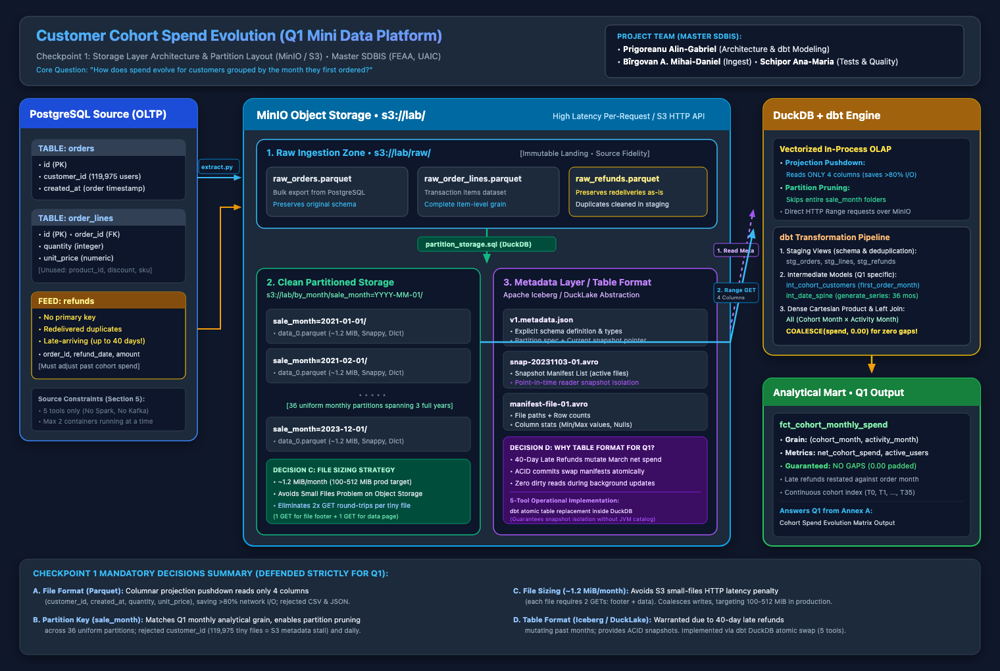
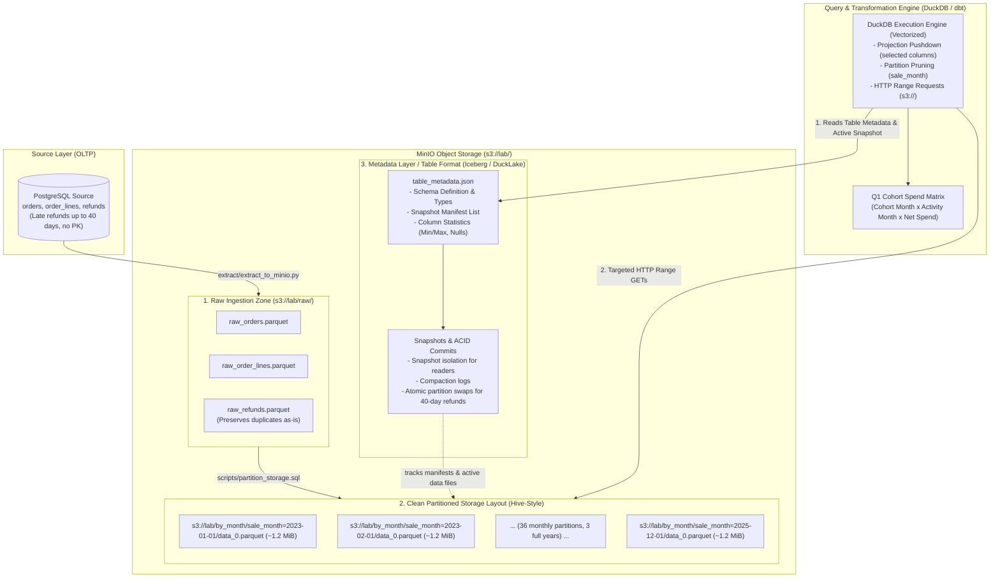

# Checkpoint 1 (Week 6): Storage Layer Design for Question 1

**Course:** Big Data: Persistence Systems and Data Processing Languages  
**Academic Program:** Master SDBIS, Faculty of Economics and Business Administration (FEAA), Alexandru Ioan Cuza University of Iași  
**Lecturer:** Ionuț Hrubaru, PhD  
**Project Team:**
* **Prigoreanu Alin-Gabriel** (Architecture design, DuckDB pipeline, dbt modeling)
* **Bîrgovan A. Mihai-Daniel** (PostgreSQL ingestion, MinIO extraction)
* **Schipor Ana-Maria** (Data quality testing, dimensional modeling)  
**Project:** Customer Cohort Spend Evolution (Q1 Mini Data Platform)  
**Deliverable Scope:** Storage Layer Architecture & Technical Decision Defense (Formative evaluation, half-laboratory, no slides, no running code required yet, individual oral defense).

**Target Analytical Question (Q1 from Annex A):**
> *"How does spend evolve for customers grouped by the month they first ordered?"*  
> **What Q1 forces you to decide (Annex A):** *"A cohort dimension and a complete date spine, with no gaps."*

---

## 1. Storage Architecture Diagram (MinIO / S3)

The architecture below captures the end-to-end data lifecycle on MinIO (`s3://lab/`) conforming strictly to the platform stack (PostgreSQL, Python, DuckDB, dbt, MinIO).

> 🖼️ **Visual Architecture Diagram Files:**
> * **Vector Format (SVG):** [docs/diagrams/storage_architecture.svg](diagrams/storage_architecture.svg)
> * **High-Resolution Image (PNG):** [docs/diagrams/storage_architecture.png](diagrams/storage_architecture.png)
> 
> 

### 1.1 Architecture Flowchart (Mermaid)



### 1.2 Physical S3 Layout on MinIO (`s3://lab/`)

```text
s3://lab/
├── raw/                                        <-- 1. RAW INGESTION ZONE
│   ├── raw_orders.parquet                      (Bulk immutable export from PostgreSQL)
│   ├── raw_order_lines.parquet
│   └── raw_refunds.parquet                     (Includes duplicates from redeliveries)
│
├── by_month/                                   <-- 2. CLEAN PARTITIONED STORAGE LAYOUT
│   ├── metadata/                               <-- 3. METADATA LAYER (TABLE FORMAT)
│   │   ├── v1.metadata.json                    (Schema, partition specs, snapshot log)
│   │   ├── snap-20231103-01.avro               (Manifest list of active Parquet files)
│   │   └── manifest-file-01.avro               (File paths, row counts, min/max statistics)
│   │
│   ├── sale_month=2023-01-01/                  <-- HIVE-STYLE PARTITIONS
│   │   └── data_0.parquet                      (~1.2 MiB, Snappy compressed, dictionary encoded)
│   ├── sale_month=2023-02-01/
│   │   └── data_0.parquet
│   ├── ...                                     (36 monthly partitions for 3 years)
│   └── sale_month=2025-12-01/
│       └── data_0.parquet
```

### 1.3 How to Sketch This on Paper in 30 Seconds During the Defense

When Dr. Hrubaru asks you to draw your storage architecture on paper or the whiteboard:
1. Draw a box on the left: **PostgreSQL** (`orders`, `order_lines`, `refunds`).
2. Draw a big container for **MinIO (`s3://lab/`)** with three horizontal boxes:
   * **Top:** `raw/` (`raw_orders.parquet`, `raw_refunds.parquet` with duplicates).
   * **Middle:** `by_month/metadata/` (Table format: schema + snapshot manifests).
   * **Bottom:** `by_month/sale_month=YYYY-MM-01/data_0.parquet` (36 files, ~1.2 MiB each).
3. Draw a box on the right: **DuckDB / dbt**.
4. Draw arrows:
   * Arrow 1: Ingest Python script writes raw Parquet to `raw/`.
   * Arrow 2: DuckDB partition script writes partitioned Parquet to `by_month/`.
   * Arrow 3: Metadata points to active Parquet partitions.
   * Arrow 4: DuckDB reads metadata first, then uses HTTP Range requests on Parquet.

---

## 2. The 4 Mandatory Decisions (Defended for Q1)

Dr. Hrubaru expects arguments formulated in the **3-Sentence Structure**:
1. **The Choice.**
2. **The Rejected Alternative (with a direct reason from Q1).**
3. **The Cost of the choice (the trade-off you accept).**

---

### Decision A: File Format (Parquet vs. CSV / JSON)

* **Sentence 1 (Choice):**  
  *"We store analytical data in columnar Apache Parquet files with Snappy compression."*
* **Sentence 2 (Rejected Alternative & Q1 Reason):**  
  *"We rejected CSV and JSON lines because answering Q1 (cohort spend evolution) reads selected columns such as `customer_id`, `created_at`, `quantity` and `unit_price`; net spend also needs order/refund linkage, whereas row-based formats force scanning all unused attributes like delivery addresses and payment tokens."*
* **Sentence 3 (Cost & Trade-off):**  
  *"The cost of our choice is that data cannot be directly inspected with standard Unix text tools and writes require schema-on-write CPU overhead; we accept it because Parquet projection pushdown avoids fetching unused columns; actual network savings require query measurements."*

---

### Decision B: Partition Key (`sale_month=YYYY-MM-01`)

* **Sentence 1 (Choice):**  
  *"We partition transaction data by calendar month of sale (`sale_month=YYYY-MM-01`)."*
* **Sentence 2 (Rejected Alternative & Q1 Reason):**  
  *"We rejected partitioning by `customer_id` because 119,975 customers would produce 119,975 tiny files of 16 rows (~400 bytes), adding listing and footer overhead; and we rejected daily partitioning (`sale_day`) because Q1 evaluates cohorts at a monthly grain, making 1,096 daily files an unnecessary fragmentation."*
* **Sentence 3 (Cost & Trade-off):**  
  *"The cost of our choice is that within each monthly partition DuckDB must scan the full month to filter individual customers; we accept it because 36 monthly files align exactly with Q1's analytical grain and allow partition pruning when queries explicitly filter activity months using sale_month."*

---

### Decision C: File Sizing Strategy

* **Sentence 1 (Choice):**  
  *"We consolidate data into single files per partition, using a chosen target of 100 MiB to 256 MiB (compare W5 companion section 7), yielding ~1.2 MiB per month for our 42 MiB didactic dataset."*
* **Sentence 2 (Rejected Alternative & Q1 Reason):**  
  *"We rejected micro-batching or multiple files per partition because each file adds metadata and data requests; their number depends on the query, which would drown queries in network latency."*
* **Sentence 3 (Cost & Trade-off):**  
  *"The cost of our choice is that monthly writes must be coalesced in memory before committing to S3; we accept it because the 100x design projects roughly 117–120 MiB/month; the 1.2 MiB lab files are only an experiment, and today’s ~42 MiB normally stays one file."*

---

### Decision D: Whether a Table Format is Warranted (Iceberg / DuckLake)

* **Sentence 1 (Choice):**  
  *"Yes, an open table format abstraction on top of Parquet files is architecturally warranted for Q1."*
* **Sentence 2 (Rejected Alternative & Q1 Reason):**  
  *"We rejected unmanaged Hive directory scraping (`read_parquet('s3://lab/by_month/**/*.parquet')`) because refunds arrive up to 40 days late, meaning an April refund for a March order requires retroactively updating March's net spend—which in raw Parquet risks concurrent readers hitting partially rewritten or missing files."*
* **Sentence 3 (Cost & Trade-off):**  
  *"The cost of our choice is the metadata management complexity of tracking snapshot manifests; we accept it because ACID snapshot isolation allows retroactive refund updates without corrupting in-flight cohort queries."*

> **Crucial Defense Follow-up (5-Tool Constraint vs Table Format):**  
> If Dr. Hrubaru asks: *"Section 5 of my brief states that Iceberg is demonstrated in lectures and is NOT in your 5 platform tools. How do you implement this in your running platform?"*  
> **Your Answer:**  
> *"Architecturally, the storage layer design warrants a table format contract because of 40-day late refunds. However, to respect the strict 5-tool, 2-container operational constraint (no JVM, no catalog server), this checkpoint proposes the guarantees rather than claiming an implementation. W6 demonstrates DuckLake through DuckDB with a PostgreSQL catalog; ordinary dbt table replacement alone does not manage snapshots of MinIO files."*

---

## 3. Defense Preparation for the Specific Q1 Question (Annex A)

### The Mandatory Requirement:
> *"A cohort dimension and a complete date spine, with no gaps."*

### Why Q1 Fails Without This (The Sparsity Problem)
Real-world retail customers do not purchase every consecutive month. If a cohort (e.g., customers acquired in `2023-01`) places orders in Month 0 (`2023-01`) and Month 2 (`2023-03`), but makes zero purchases in Month 1 (`2023-02`):
* A naive SQL query with `GROUP BY cohort_month, order_month` will **omit Month 1 completely**.
* If Month 1 is missing, downstream calculations (retention matrices, average order decay curves, rolling 3-month spend) will treat Month 2 as Month 1, shifting the timeline and producing mathematically false metrics.

### The dbt Solution Architecture

```text
[stg_orders] ──► [int_cohort_customers] (Calculate first_order_month per customer)
                        │
                        ▼ (CROSS JOIN with valid calendar months)
[int_date_spine] ──► [Cartesian Grid: all Cohort Months x Activity Months where Activity >= Cohort]
                        │
                        ▼ (LEFT JOIN on actual net spend)
[fct_cohort_monthly_spend] ──► COALESCE(spend, 0.00) prevents missing periods
```

1. **Cohort Dimension (`int_cohort_customers`):**  
   We extract each customer's earliest order timestamp: `MIN(created_at)` truncated to the first day of the month (`first_order_month`). This fixes each customer into an immutable acquisition cohort.
2. **Complete Date Spine (`int_date_spine`):**  
   We generate an unbroken sequence of 36 months using DuckDB's `range()` / `generate_series()`:
   ```sql
   SELECT CAST(range AS DATE) AS activity_month
   FROM range(DATE '2023-01-01', DATE '2026-01-01', INTERVAL 1 MONTH);
   ```
3. **Cartesian Product (Dense Lifecycle Grid):**  
   We cross join each cohort month with all activity months where `activity_month >= cohort_month` (since a cohort cannot spend before it was acquired).
4. **Left Join & Zero-Padding (`fct_cohort_monthly_spend`):**  
   We `LEFT JOIN` transaction spend onto this dense grid. Inactive months return `NULL`, which is explicitly coalesced:
   ```sql
   -- Aggregate lines and valid refunds separately per order before subtracting;
   -- then aggregate order net amounts by cohort_month and activity_month.
   COALESCE(net_cohort_spend, 0.00) AS net_cohort_spend
   ```

---

## 4. The 40-Day Late Refund Defense (A Classic Interview Question)

Dr. Hrubaru's brief specifically states:
> *"what happens to a published number when a refund arrives forty days late."*

### How to Answer:

| Accounting Strategy | What Happens | Why We Choose It for Q1 |
| :--- | :--- | :--- |
| **Strategy 1: Restate History (Order Month)**<br/>*(Our Choice)* | When a March order is refunded in April (40 days later), the refund is attributed to **March's cohort spend**. | **Q1 measures cohort spend evolution.** If we booked the refund in April, April would show negative spend for a customer who bought nothing in April! For true cohort LTV, refunds must reduce the revenue of the cohort acquisition/order period. The published March number changes retroactively, which is why we choose consistent snapshots for readers during restatement. |
| **Strategy 2: Cash Accounting (Refund Month)**<br/>*(Rejected for Q1)* | The refund is booked in the month it was issued (April). March's published number remains static. | Rejected because it pollutes Month 1 activity with Month 0 returns, distorting customer retention and basket value decay. |

### How to Handle Refund Redeliveries and Missing Primary Keys:
Annex A states: *"the refunds feed that arrives up to forty days late, carries no primary key, and is occasionally redelivered."*
* **In Raw Zone:** We land refunds as-is, preserving duplicates (lost duplicate = lost observation).
* **In dbt Staging:** We generate a deterministic surrogate key using `dbt_utils.generate_surrogate_key(['order_id', 'refunded_at', 'amount'])` as a candidate identity, not a guaranteed key: two real refunds can share those values. A deduplication rule must distinguish replayed deliveries under a documented feed assumption; implementation is later work.

---

## 5. Quick Oral Defense Cheat Sheet (Master Reference)

| Question from Professor | Your 10-Second Bulletproof Answer |
| :--- | :--- |
| **1. Walk me through your storage diagram.** | *"Data enters PostgreSQL, extracts to `s3://lab/raw/` Parquet files. DuckDB partitions them into `s3://lab/by_month/sale_month=YYYY-MM-01/`. A metadata table format tracks snapshot manifests. DuckDB uses HTTP Range requests to read footers and stream columns into vector memory."* |
| **2. Why Parquet over CSV/JSON?** | *"Projection pushdown. Q1 reads customer, date and spend columns; net spend also needs order/refund linkage. Parquet lets DuckDB request only those byte ranges, avoiding unused columns; exact savings must be measured."* |
| **3. Why partition by `sale_month` instead of `customer_id`?** | *"119,975 customers creates 119,975 directories with 400-byte files, killing MinIO with HTTP listing and footer latency. 36 monthly partitions matches Q1's monthly grain and enables partition pruning."* |
| **4. Why not partition by day?** | *"1,096 daily partitions for 3 years causes excessive fragmentation without analytical benefit, because Q1 computes cohort metrics strictly at the monthly level."* |
| **5. Why ~1.2 MiB file sizing?** | *"At 100x, 36 monthly files average roughly 117–120 MiB. The 1x 1.2 MiB files are experimental; many small files add metadata requests."* |
| **6. Is a Table Format warranted?** | *"Yes. Late refunds arrive up to 40 days later, modifying past months. A table format provides ACID snapshots so historical restatements never disrupt concurrent cohort queries."* |
| **7. How do you implement Table Format with only 5 tools?** | *"W6 demonstrates DuckLake through DuckDB with a PostgreSQL catalog; this checkpoint does not require it implemented. dbt replacement alone does not provide those file-set guarantees."* |
| **8. How do you solve the date spine requirement?** | *"Real data is sparse. We generate a full 36-month spine with `generate_series`, cross join with cohorts to establish all valid lifecycle months, and left join spend with `COALESCE(spend, 0.00)` so no months are missing from the matrix."* |
| **9. What happens to a published number when a refund arrives 40 days late?** | *"It is restated retroactively against the order month to preserve the true cohort spend evolution. The published number updates under a new snapshot."* |
| **10. How do you handle refund redeliveries without a primary key?** | *"Land duplicates in raw; generate a surrogate hash key on `(order_id, refund_date, amount)` and deduplicate with window functions in staging."* |


### Checkpoint measurement evidence

The completed W5 writes produced 36 monthly files totalling 45,429,805 bytes (mean 1.20348 MiB), versus the source-size estimate 1.16584 MiB: about 3.23% larger. Daily files average 55.5 KiB versus an estimate of 39.2 KiB. Actual counts/sizes and successful checks are saved in `results/w05_actual/`. These measurements support the checkpoint; a finished cohort platform or completed W6 lab is not required. The JSON/Avro metadata pictured above is a conceptual Iceberg example, not DuckLake’s physical SQL catalog.

The proposed raw_refunds.parquet preserves all rows from the input CSV while changing only the file format. The checkpoint asks for an explicit landing format; keeping CSV instead would also be valid.
